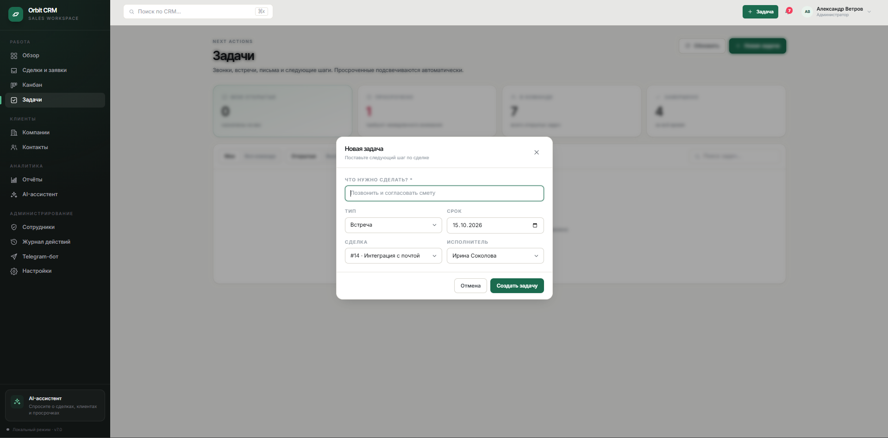
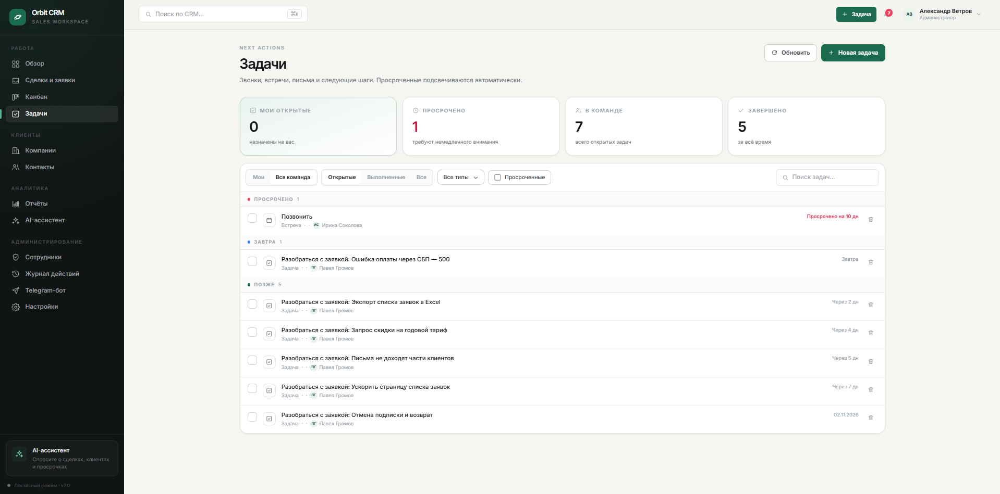
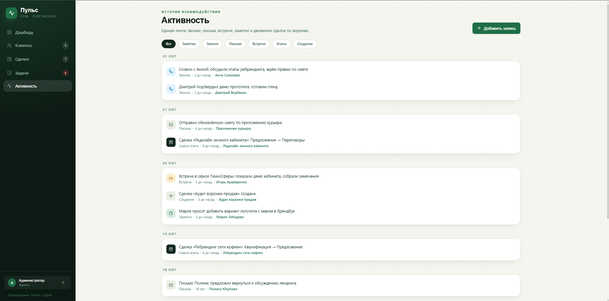

# Orbit CRM — CRM для рекрутингового агентства с AI-оценкой кандидатов

## Скриншоты

| Дашборд | Сделки (kanban) | AI-чат |
|---|---|---|
|  |  |  |

| Клиенты | Аналитика | Аудит/роли |
|---|---|---|
|  |  |  |

Полноценная CRM: компании → контакты → заявки (вакансии) → кандидаты, дашборд, аудит-лог всех действий, AI-ассистент и Telegram-бот. Промышленная структура: routers / services / schemas / models, rate limiting, seeding, тесты.

## Стек
- **Backend:** FastAPI, SQLAlchemy 2.0, SQLite (легко меняется на Postgres), Pydantic v2
- **Frontend:** Jinja2 + TailwindCSS + Alpine.js (SPA-подобный UX без сборщика)
- **Auth:** JWT (cookie + Bearer), роли admin / manager / employee
- **AI:** OpenAI-совместимый API (Ollama / OpenAI / любой провайдер)
- **Бот:** aiogram 3 — уведомления и действия из Telegram

## Фичи
- Воронка заявок с прогресс-статусами, AI-скоринг кандидатов под вакансию
- Аудит-лог: кто / что / когда — каждое действие в системе
- Rate limiting на чувствительные эндпоинты
- Дашборд с метриками, уведомления в Telegram
- Покрыто pytest-тестами

## Запуск
```bash
cp .env.example .env
pip install -r requirements.txt
python run.py            # http://localhost:8000
```

## Структура
```
app/routers/    REST-эндпоинты (companies, contacts, applications, ai, auth...)
app/services/   бизнес-логика (crm, ai_service, stats, notifications)
app/bot/        Telegram-бот (aiogram 3)
tests/          pytest
```
