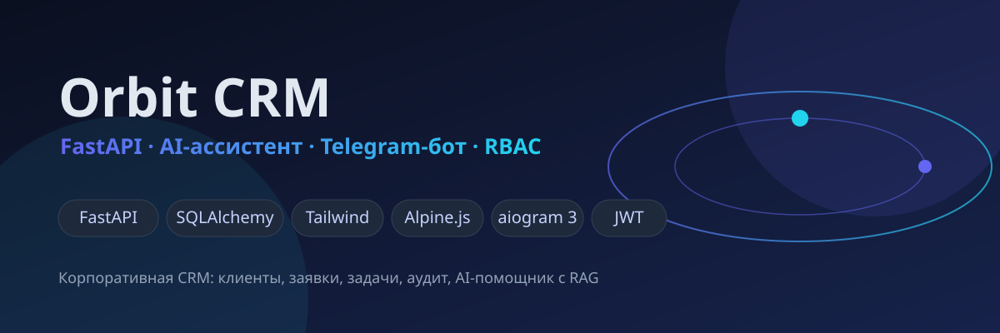
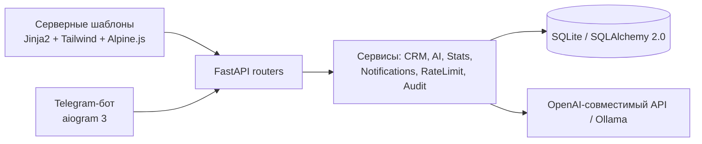
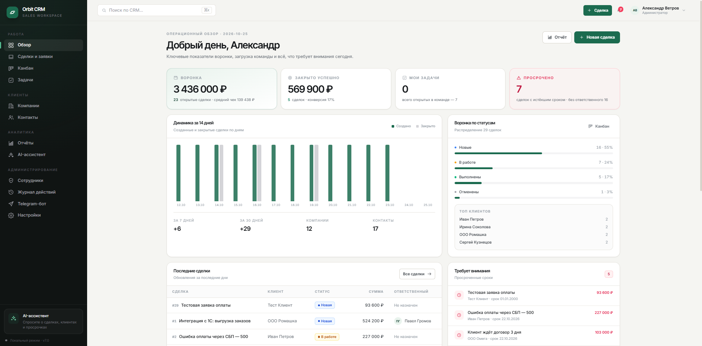
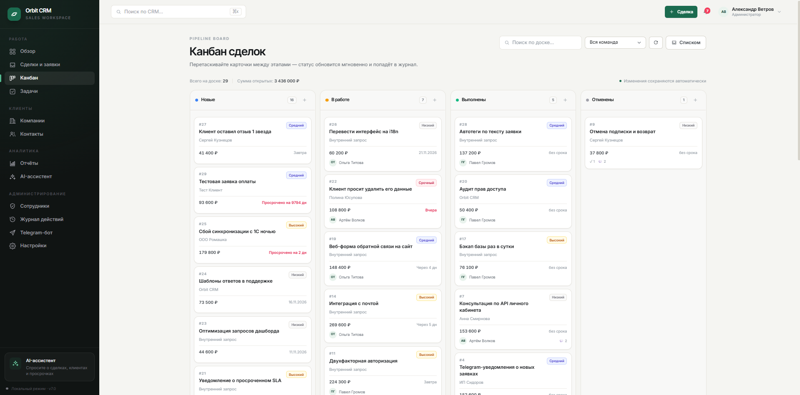
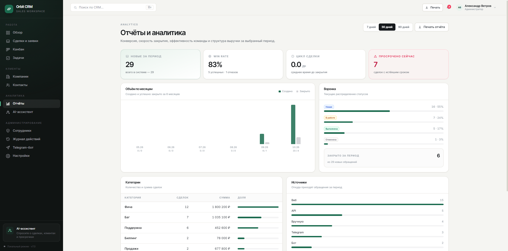
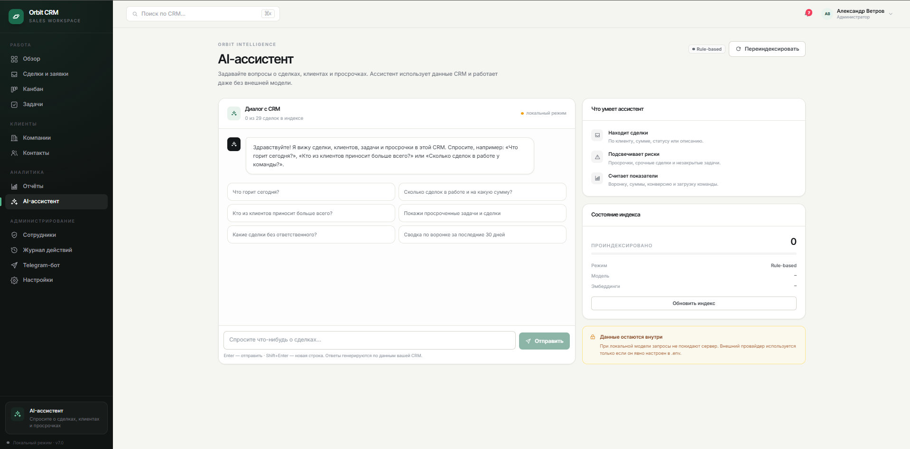
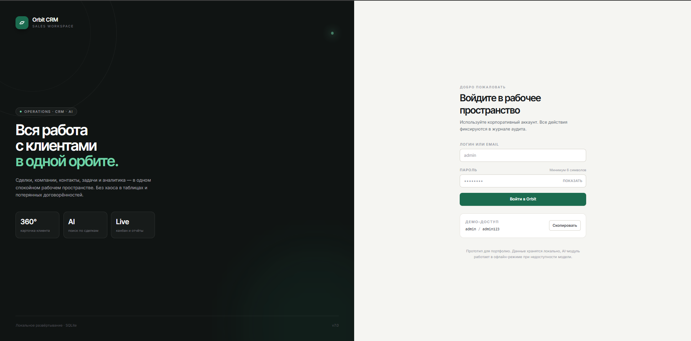

# Orbit CRM




Корпоративная CRM для отдела продаж и сервисных команд: клиенты, компании, контакты, заявки (applications), задачи, роли и аудит. Встроенный AI-ассистент с RAG по базе знаний и Telegram-бот для работы вне офиса. Эволюция проекта [mini-crm](https://github.com/nwl01234/mini-crm) — добавлены многопользовательский RBAC, коммерческая структура (компании/контакты), rate-limiting и уведомления.

## Возможности

- **Клиентская база** — компании, контакты, привязка заявок к клиентам
- **Заявки и задачи** — жизненный цикл заявки, назначение сотрудников, статусы
- **Роли и доступ (RBAC)** — admin / manager / employee с разграничением прав
- **AI-ассистент** — ответы на вопросы по базе знаний (RAG), подсказки по заявкам, OpenAI-совместимый API или локальная Ollama
- **Telegram-бот** — приём заявок от клиентов, уведомления сотрудникам, статус в реальном времени
- **Аудит** — журнал действий «кто / что / когда / почему»
- **Уведомления** — in-app + Telegram, сервис notification_service
- **Безопасность** — JWT (cookie + Bearer), passlib/bcrypt, rate limiting

## Архитектура



```
app/
├── main.py            # точка входа FastAPI
├── routers/           # auth, dashboard, companies, contacts,
│                      # applications, users, ai, bot, logs, profile
├── services/          # ai_service, crm, stats, notification_service,
│                      # rate_limit, logging_service, seed
├── bot/               # Telegram-бот (aiogram 3)
└── models.py / schemas.py / security.py / deps.py
```

## Быстрый старт

```bash
python -m venv .venv
.venv\Scripts\activate          # Windows
pip install -r requirements.txt
cp .env.example .env            # заполнить переменные
python run.py                   # http://localhost:8000
```

`.env.example` содержит все переменные: `BOT_TOKEN`, `OPENAI_API_KEY` / `OLLAMA_URL` и т.д.

**Демо-аккаунты** (создаются при первом запуске через seed):

| Логин | Пароль | Роль |
|---|---|---|
| `admin` | `admin123` | администратор |
| `manager` | `manager123` | менеджер |
| `dev1` | `emp12345` | сотрудник |

## Стек

| Слой | Технологии |
|---|---|
| Backend | Python 3.11+, FastAPI, SQLAlchemy 2.0, SQLite, pydantic |
| Frontend | Jinja2, Tailwind CSS, Alpine.js (без сборки — статика отдаётся из `static/`) |
| Auth | JWT (HttpOnly cookie + Bearer), bcrypt |
| AI | OpenAI-совместимый API, Ollama, RAG-контекст из базы знаний |
| Бот | aiogram 3.x, FSM |
| Тесты | pytest |

## Roadmap

- [ ] PostgreSQL-профиль
- [ ] Файлы/вложения в заявках
- [ ] REST API для мобильных клиентов
- [ ] Воронка продаж (kanban)

## Скриншоты

| | |
|---|---|
|  |  |
|  |  |
|  |  |
|  | |

---
Часть портфолио: [mini-crm](https://github.com/nwl01234/mini-crm) → **orbit-crm** → [pulse-crm](https://github.com/nwl01234/pulse-crm) · [business-flow-automator](https://github.com/nwl01234/business-flow-automator)
